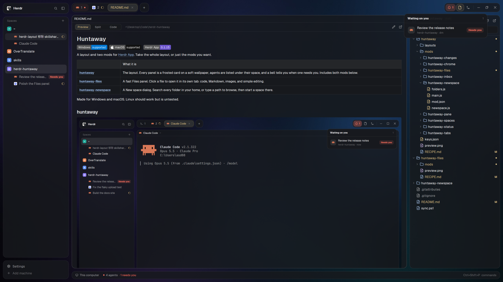
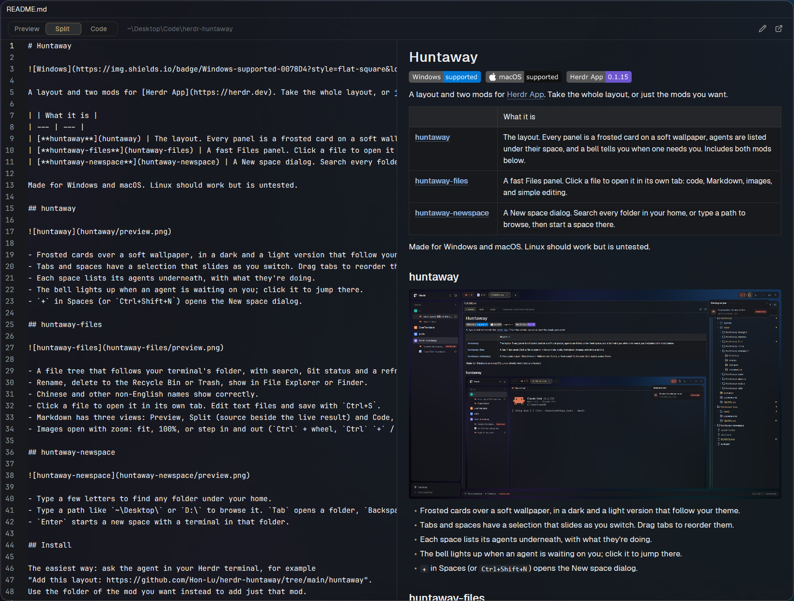
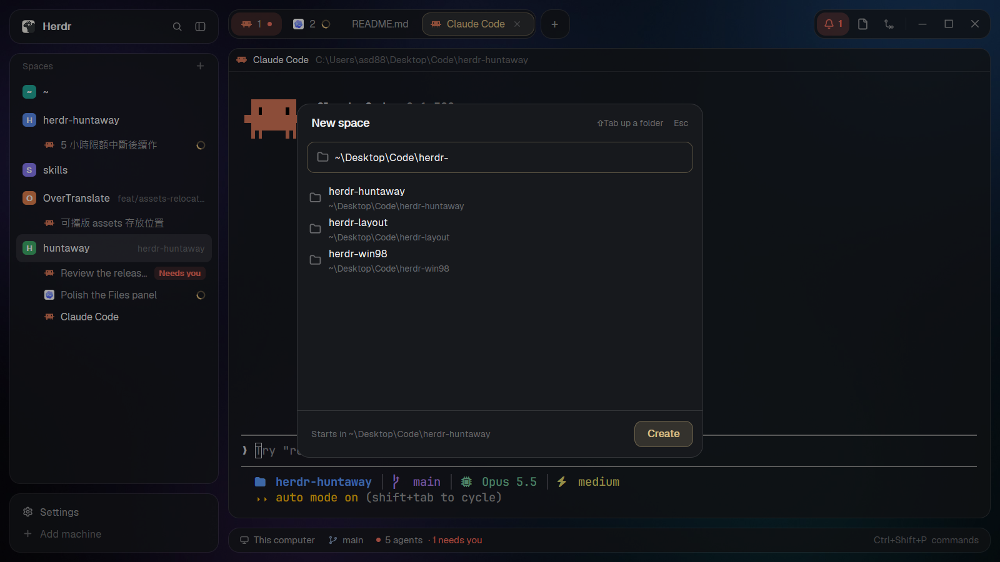

# Huntaway

  

A layout and two mods for [Herdr App](https://herdr.dev). Take the whole layout, or just the mods you want.

| | What it is |
| --- | --- |
| [**huntaway**](huntaway) | The layout. Every panel is a frosted card on a soft wallpaper, agents are listed under their space, and a bell tells you when one needs you. Includes both mods below. |
| [**huntaway-files**](huntaway-files) | A fast Files panel. Click a file to open it in its own tab: code, Markdown, images, and simple editing. |
| [**huntaway-newspace**](huntaway-newspace) | A New space dialog. Search every folder in your home, or type a path to browse, then start a space there. |

Made for Windows and macOS. Linux should work but is untested.

## huntaway



- Frosted cards over a soft wallpaper, in a dark and a light version that follow your theme.
- Tabs and spaces have a selection that slides as you switch. Drag tabs to reorder them.
- Each space lists its agents underneath, with what they're doing.
- The bell lights up when an agent is waiting on you; click it to jump there.
- `+` in Spaces (or `Ctrl+Shift+N`) opens the New space dialog.

## huntaway-files



- A file tree that follows your terminal's folder, with search, Git status and a refresh button.
- Rename, delete to the Recycle Bin or Trash, show in File Explorer or Finder.
- Chinese and other non-English names show correctly.
- Click a file to open it in its own tab. Edit text files and save with `Ctrl+S`.
- Markdown has three views: Preview, Split (source beside the live result) and Code, with images shown, including HTML ``, centered blocks, badges and images in tables.
- Images open with zoom: fit, 100%, or step in and out (`Ctrl` + wheel, `Ctrl` `+` / `-`).

## huntaway-newspace



- Type a few letters to find any folder under your home.
- Type a path like `~\Desktop\` or `D:\` to browse it. `Tab` opens a folder, `Backspace` goes up.
- `Enter` starts a new space with a terminal in that folder.

## Install

The easiest way: ask the agent in your Herdr terminal, for example
"Add this layout: https://github.com/Hon-Lu/herdr-huntaway/tree/main/huntaway".
Use the folder of the mod you want instead to add just that mod.

To do it by hand, clone the repository, then copy what you want into `~/.config/herdr-app`.

**Windows (PowerShell)**

```powershell
git clone https://github.com/Hon-Lu/herdr-huntaway "$HOME\herdr-huntaway"
$r = "$HOME\herdr-huntaway"; $h = "$HOME\.config\herdr-app"

# The whole layout
Copy-Item -Recurse -Force "$r\huntaway\mods\*" "$h\mods\"
Copy-Item -Force "$r\huntaway\layouts\*" "$h\layouts\"
herdr-app do layout.switch --name huntaway

# Or only one mod
Copy-Item -Recurse -Force "$r\huntaway-files\mods\*" "$h\mods\"
Copy-Item -Recurse -Force "$r\huntaway-newspace\mods\*" "$h\mods\"
```

**macOS / Linux**

```sh
git clone https://github.com/Hon-Lu/herdr-huntaway ~/herdr-huntaway
r=~/herdr-huntaway; h=~/.config/herdr-app

# The whole layout
cp -R "$r"/huntaway/mods/* "$h"/mods/
cp "$r"/huntaway/layouts/* "$h"/layouts/
herdr-app do layout.switch --name huntaway

# Or only one mod
cp -R "$r"/huntaway-files/mods/* "$h"/mods/
cp -R "$r"/huntaway-newspace/mods/* "$h"/mods/
```

Then:

- **Shortcut for New space**: add the lines from the folder's `keys.json` to your `~/.config/herdr-app/keys.json`.
  The layout's binds `Ctrl+Shift+N` only while huntaway shows; the mod's binds it everywhere, in place of Herdr's own new space.
- **huntaway-files in another layout**: in your layout file, point the Files block at it: `"content": { "mod": "huntaway-files" }`.

`Ctrl+Shift+L` switches back to Herdr's own layouts. To update, `git pull` and copy again.

## Good to know

- The wallpaper and card edges follow your theme. To use your own picture or a plain color, change `background` at the bottom of `layouts/huntaway.json`.
- Git is optional. Without it, Files still browses and searches, just without Git status.
- Some mods in the layout are restyled copies of Herdr's own (spaces, tabs, status bar, pane header, Changes). They don't update with Herdr; if something looks off after a Herdr update, update this repository too.
- Each folder has a `RECIPE.md`: a description an agent can rebuild it from.
