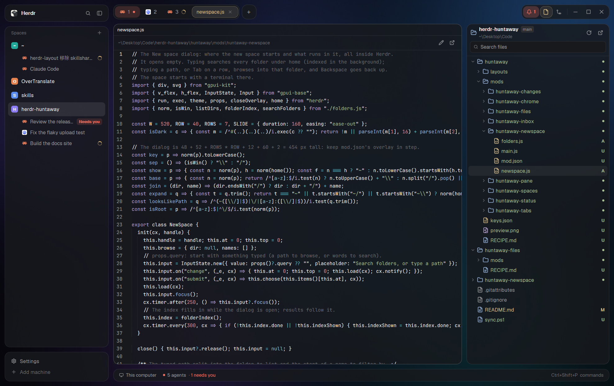

# Huntaway Files

A Files panel that is quick on big folders and reads every name right, including Chinese ones.
It follows your terminal's folder, shows Git status, and opens each file in a tab of its own,
where code, Markdown and images display and text files can be edited and saved.

## What you see

The panel:
- A header: an open-folder icon, the folder's name with its Git branch in a small chip, the parent
  path under it, then two buttons: refresh (a spinner while loading) and open the folder in the
  system's file manager.
- A search field ("Search files").
- The tree, 26 px rows: folders first, then files, sorted by name with numbers in order. File
  icons are colored by type (code, config, text, image, archive). Git marks sit on the right:
  modified, added, deleted, renamed, untracked, conflict; ignored files are dimmed.
  `.git`, `.DS_Store`, `Thumbs.db` and `desktop.ini` are never shown.
- Right-click menu:
  - a file: Open, Open with its app, Show in File Explorer (Finder on macOS), Copy path,
    Copy relative path, Rename…, Delete…
  - a folder: New file…, New folder…, Show in File Explorer, Copy path, Copy relative path,
    Rename…, Delete…
  - empty space: New file…, New folder…, Show in File Explorer, Copy path.
- Rename and New open a small dialog with the name selected (without its extension); Delete asks
  first and moves the item to the Recycle Bin (Windows) or Trash (macOS, Linux).

A file tab (one per file; opening it again shows the same tab):
- A header with the folder (and the name, unless the layout's pane header already shows it), then
  the pencil (Edit) and Open with its app.
- Code with syntax colors, Markdown rendered (links open other files in their own tabs), images,
  or "Binary file — no preview" with Open with its app and Show in folder.
- Editing: the header becomes Cancel (a crossed pencil, in the same place as Edit) and Save
  (a disk icon, tinted when there are changes). Cancel throws the changes away; Save or
  `Ctrl+S` (`Cmd+S`) writes the file. Line endings and a BOM are kept. If the file changed on
  disk meanwhile, the save is refused with a notice.

## How it behaves

- The tree follows the focused terminal's folder (in another machine's terminal, that machine's
  files) and refreshes itself when files change; F5 or the button refreshes by hand.
- Expanded folders are remembered per root.
- Keys in the tree: arrows, Page Up/Down, Home/End, Enter (open), Left/Right (fold), F2 (rename),
  Delete, `Ctrl+F` (search), Esc (clear the search), `Ctrl+C` (copy the path).
- Search matches file names under the root, using `git ls-files` when the folder is a repo.
- In the huntaway layout the panel is frosted glass; anywhere else it is solid.

## Built from

- `mods/huntaway-files/`: `mod.json` (`place: none`, `focusable`), `main.js` (picks a role from
  `props().role`: the panel, `menu`, `dialog` or `viewer`), `panel.js`, `menu.js`, `preview.js`,
  `open.js`, `system.js`, `paths.js`, `ui.js`, `icons/`.
- Put it in a layout as a block: `"content": { "mod": "huntaway-files" }` (Herdr's own layouts use
  the block id `files` in the stack `panel-body`).
- Files are opened with `tab.new {name, mod: "huntaway-files", props: {role: "viewer", file, on}}`;
  shared state `huntaway-files.tabs` maps files to their tabs, and `huntaway-files.request` carries
  changes from the menus and dialogs to the panel.
- Reading folders: `fs/promises` inside home; elsewhere one PowerShell call (Windows) or `sh`
  (macOS, Linux) lists many folders at once.
- Programs it runs: `git` (status, branch, file list), PowerShell or `sh`, `explorer.exe` /
  `open` / `xdg-open`.

## Watch out

- Windows PowerShell writes in the console's code page, which turns non-English names into
  garbage; every script sets `[Console]::OutputEncoding` to UTF-8 and is passed with
  `-EncodedCommand`.
- `image()` only loads paths under the Herdr folder: previews are copied into
  `.cache/huntaway-files/` first and removed later.
- Use `v_virtual_list` for the tree (`uniform_list` ignores `track_scroll`).

## Done when

- `herdr-app check mods/huntaway-files` passes.
- A folder with Chinese names lists them correctly, on another drive too.
- Clicking a file opens a tab named after it; clicking it again shows that tab.
- Edit, change a line, Cancel: the text is back. Edit, change, `Ctrl+S`: the file on disk changed.
- Delete moves the file to the Recycle Bin or Trash, and the tree updates.
