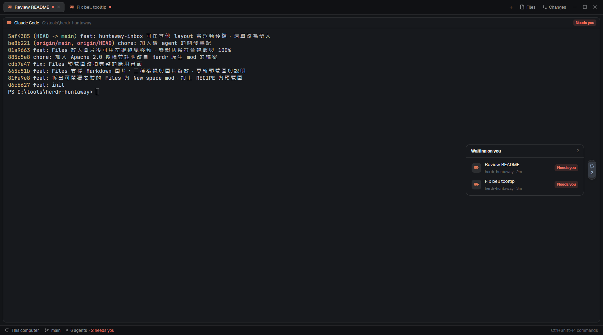

# Huntaway Inbox

A small bell on the edge of the window that shows up when agents are waiting on you: it breathes
in the most urgent agent's color and shows how many. Click it and a list slides out beside it with
every agent that needs you or has finished, blocked first; click one to go there.

## Install

Copying the mod folder isn't enough: nothing shows until a layout places the bell. Add the
floating entry (see Built from) to the block with `"content": { "tab": "active" }` in the
person's layout. If that layout is one of Herdr's own (read-only), tell the person and, with
their OK, clone it first (`layout.clone`) and add it to the clone, which they then switch to.
In huntaway, skip this: its tab bar already has the bell.

## What you see

- Nothing, while no agent is blocked or done.
- Otherwise a bell in Herdr's floating frame, 12 px in from the edge it sits on (top right at
  first): a 22 px wide column with a 14 px bell glyph over the count (11 px, semibold; `99+` past
  99). In the middle of the top or bottom edge the two sit side by side instead (22 px tall).
  The glyph is in the `blocked` color when any agent is blocked, else the `done` color, and
  breathes (opacity 0.35 to 1, every 2 s when blocked, 2.6 s when only done). The tooltip says
  "N waiting on you · drag to move".
- While the list is open the bell holds still in `accent`, on an `accent` tint (15%).
- The list ("Waiting on you") is a 340 px card, 10 px from the bell, with 14 px corners, a 1 px
  rim (`#ffffff1f` on dark themes, `#0000001a` on light ones) and the theme's `background` at
  94%: a 38 px header with the count, then one 46 px row per agent (the program's icon on a 28 px
  `raised` tile, the agent's title, its space and how long ago, a `Needs you` or `Done` pill in
  its status color). Seven rows show, then it scrolls.

## How it behaves

- Agents come from Herdr: blocked ("Needs you") first, then done (finished while you weren't
  looking); newest first within each. A done agent drops off once you look at it, a blocked one
  once it's answered, and the bell goes when the list is empty.
- Clicking the bell opens the list toward the middle of the window: left of the bell on the right
  edge, right of it on the left edge, below or above it in the middle of the top or bottom edge.
  Along the edge it lines up with the bell (top, middle or bottom). The list slides out from the
  bell's side (300 ms spring, no overshoot) as it fades in (180 ms).
- In a corner the bell counts as being on its side edge, whichever edge Herdr put it on: top
  right and right top look and open the same.
- Clicking the bell again, anywhere outside the list, or `Esc` closes it; clicking a row closes
  it and focuses that agent's pane.
- Drag the bell to any edge; Herdr snaps it to the nearest edge and third and remembers the spot
  per layout. Dragging closes an open list.
- `Ctrl+Shift+I` (this folder's `keys.json`) goes straight to the agent at the top of the list.

## Built from

- `mods/huntaway-inbox/`: `main.js`, `bell.svg` (a stroke bell, tinted), `mod.json`
  (`place: "none"`, so installing it docks nothing).
- The layout gets the bell as a floating block over the block that shows the tabs
  (`"content": { "tab": "active" }`):
  `"floating": [{ "id": "inbox", "content": { "mod": "huntaway-inbox" }, "edge": "right", "align": "start" }]`.
  Herdr's own layouts are read-only: clone one first (`layout.clone`) and add it there.
- One mod, two parts: with `placement()` it is the bell; opened as an overlay (`props().overlay`)
  it is the list, a `popup` with `frame: "none"` and `props: { edge, height }` (the side it
  slides in from, its height). huntaway's tab bar opens the same list under its own bell.
- `herdr` functions: `agents()`, `spaces()` (tab names and when they changed), `theme()`,
  `placement()`, `openOverlay`, `closeOverlay`, `shared` / `setShared` (`huntaway-inbox.open`,
  the list's overlay id while it shows), `nextCommand()` (`next`), `run("pane.focus")`.
- It runs no programs and reads no files.

## Watch out

- A press on the bell is outside the popup, so Herdr closes the list before the bell's click
  runs: the list records when it closed (its `close()`), and a click within 250 ms of that
  doesn't open it again. Without this the bell can't close its own list.
- Herdr draws the float's frame; a mod only draws inside it. A filled glow or ring becomes a
  shape inside the frame, so only the glyph breathes and the open state is a tint.
- After a drop Herdr springs the float to its spot. Bounds read in that time are wrong, and the
  release can arrive as a click: clicks are ignored for 450 ms after a drag ends.
- A dragged float never gets a pointer leave (the pointer rides along), so nothing may depend on
  hover. That's why the list opens on click.
- A popup is as tall as its content: the list's card is absolute (it slides), so its root gets a
  fixed size, and every part has a fixed height (40 + min(388, 12 + 48 × rows), or 144 empty).
- Herdr has no offset along an edge: at the top right the bell sits over the pane header's
  buttons in layouts that have one. People can drag it away; it stays where they put it.

## Done when

- `herdr-app check mods/huntaway-inbox` passes.
- With no agent waiting, the layout shows no bell. An agent reporting `blocked` brings it up at
  the top right with `1`, breathing in the `blocked` color.
- Clicking it slides the list out to its left with that agent; clicking the row focuses its pane
  and closes the list; clicking the bell twice opens and closes it.
- Dragged to the top-middle, the bell lies across and the list opens below it.
