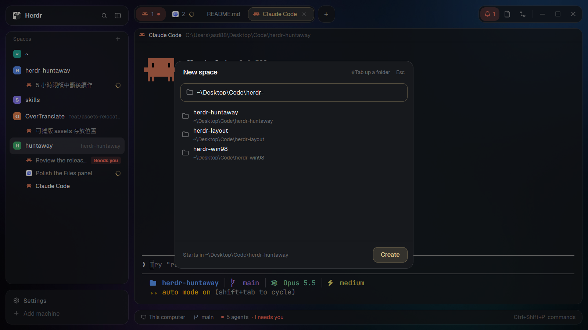

# Huntaway New Space

A dialog for starting a space in the right folder without typing `cd`. Type a path and walk down
folder by folder with the arrow keys and Tab, or type a few letters to find a folder, then press
Enter: the new space opens with a terminal there.

## What you see

A 520×454 card in the middle of the window, 16 px corners, the theme's `background`:
- A header: "New space", and on the right a hint ("Indexing N folders…" while it reads your
  folders, "⇧Tab up a folder" while browsing) and "Esc".
- A field with a yellow (`ansi3`) rim, placeholder "Type a path, or words to search"; a folder
  icon, or a search icon while it holds words.
- Up to seven 40 px rows: a folder icon (a drive icon for a drive), the folder's name and its
  path under it (`~` for home, `C:\` for a drive). The highlighted row has a `hover` fill that
  slides (160 ms) with the arrow keys or a click, and says "Tab open · ↵ create" on the right; a
  row under the pointer gets a fainter fill. Nothing is highlighted until a key or a click.
- Empty, the list offers places to start: the folders the terminals on this computer are in (and
  the spaces' start folders), home, then the drives (`/` on macOS and Linux).
- At the bottom, "Starts in <folder>" (where Enter would start the space) and a Create button in
  yellow, dimmed while there is no such folder.

## How it behaves

- The field holds where the space starts; the list suggests folders for what was typed. Up/Down
  put the highlighted folder's path in the field without changing the list; typing after that
  goes on from that path (a slash lists what is inside it).
- A path (`~\…`, `C:\…`, `D:\`, `/…`) lists that folder's subfolders, filtered by what follows the
  last slash.
- Words search the folder index, read in the background the first time the dialog opens: home
  six levels down, plus four levels under the folder that holds each folder in use
  (`C:\tools` for a terminal in `C:\tools\app`; the folder itself when it sits on a drive's top),
  up to 40,000 folders. Hidden folders and tool folders (`node_modules`, `AppData`, `venv`,
  `Program Files`, …) are skipped; build output (`bin`, `obj`, `dist`, `target`, …) is listed but
  not gone into. Every word must be in the path; a word in the folder's own name counts most, at
  its start more; shorter paths win ties.
- Where it starts: the highlighted folder; else the typed path when it ends in a slash; else the
  first row.
- Keys: Up/Down move one row (wrapping) and Page Up/Down a page; `Tab` goes into the highlighted
  folder (with none, the first row: it completes a typed name); `Right` on a highlighted row does
  the same; `Shift+Tab` goes up a folder (or back to the folder while a name is typed);
  `Backspace` right after a slash goes up a folder; `Enter` creates; `Esc` puts back what was
  typed while a row is highlighted, else closes.
- Mouse: a click highlights a row (like the arrow keys), a double click goes into it, Create
  creates.
- The space is made with `space.new {machine: "", folder}` and starts a terminal there. If the
  folder is inside a Git repo but not its top, the space is named after the folder (Herdr would
  name it after the repo); otherwise it stays unnamed and follows its terminal.

## Built from

- `mods/huntaway-newspace/`: `mod.json` declares the overlay
  (`kind: "dialog"`, `frame: "none"`, 520×454), `main.js`, `newspace.js` (the dialog),
  `folders.js` (listing, drives, the index and the search).
- Open it with `mod.open {name: "huntaway-newspace"}`: from a key (`keys.json` here binds
  `Ctrl+Shift+N` in place of Herdr's `space.new`), the palette, or another mod's button.
- Listing: `fs/promises` inside home; outside it, `sh` on macOS and Linux, and on Windows cmd's
  `dir /a:d-h /b` (about 0.2 s, any language), its output written UTF-16 (`cmd /u`) to a file in
  `.cache/huntaway-newspace/` and read back as bytes; PowerShell (UTF-8 output, about 2 s) only
  for a path with cmd's symbols in it. Drives: cmd's `if exist X:\` per letter.
  Each folder is read once while the dialog is open, and the highlighted one is read ahead.
  The index walks home with `fs/promises` and the other places with one PowerShell script (or
  `find`) each.
- Folders in use: `panes()` (each terminal's `cwd`) and `spaces()` (`folder`, this computer only).
- Programs it runs: `git rev-parse --show-toplevel` (to name the space), PowerShell, `sh` or `find`.

## Watch out

- A trailing slash means "inside this folder": keep it when splitting the typed path.
- The list follows what was typed (`query`), not the field: a highlighted row's path in the field
  must not filter the list down to that one row. The field's `change` for that path is ignored.
- `fs/promises` reads only inside home: anything else goes through cmd, PowerShell or `sh`.
- cmd run by Herdr has no console, so `chcp 65001` does nothing and its stdout garbles
  non-English names: `cmd /u` redirected to a file writes UTF-16, read with `fs.readFile` and
  decoded by hand (await the file's removal, or a closing dialog leaves it).
- A space's `folder` is where new terminals start, not where they are now (empty for home).
- Terminals may report folders in other letter case; compare paths case-insensitively.
- The dialog's parts have fixed heights; keep `mod.json`'s overlay height in step
  (48 + 52 + 7 × 40 + 12 + 60 + 2 = 454).

## Done when

- `herdr-app check mods/huntaway-newspace` passes.
- `herdr-app do mod.open '{"name":"huntaway-newspace"}'` shows the places to start from.
- Typing `C:\` lists its folders; Down puts one in the field and the list stays; `Tab` and
  `Shift+Tab` go in and out.
- Typing a folder's name finds it, also one next to an open space outside home.
- Enter makes a space whose terminal starts in the folder named at the bottom.
