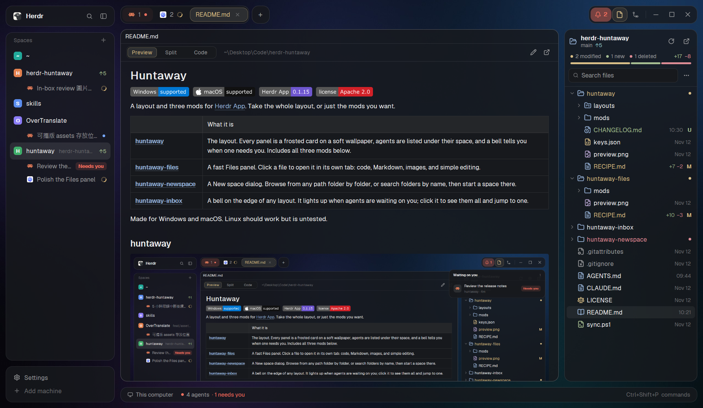

# Huntaway

Herdr's window as frosted cards on a soft wallpaper. The sidebar lists spaces with their agents
underneath, the tab bar is one card with a sliding selection, and a bell lights up when an agent
needs you. Files opens files in their own tabs, and `+` opens a New space dialog that searches
folders. It follows the theme: a dark and a light version.

## What you see

The window has no system title bar. Everything sits 12 px in from the edges on a wallpaper, with
12 px between cards. Every card has 14 px corners and a 1 px rim: `#ffffff1f` on dark themes,
`#0000001a` on light ones. Card fills are the theme's `background` at 80% opacity on dark themes
(the blurred wallpaper shows through, like frosted glass) and 96% on light ones (so terminal text
keeps its contrast on white).

Wallpaper (`mods/huntaway-chrome/backgrounds/`, 2560×1600, already blurred):
- `glass.jpg` for dark themes: near-black with large soft pools of deep blue, violet and teal.
- `mist-light.jpg` for light themes: near-neutral light gray, a little cooler at the top right.

Left column, 268 px (folds to a 44 px rail; 76 on macOS):
- **Brand** card, 44 px: Herdr logo and name, search (the picker), sidebar toggle. Drags the window.
- **Spaces** card, the rest of the height:
  - Each space is a 36 px row: a colored 18 px letter tile and its name. Repo and branch details
    follow on the right only when unusual, as in Herdr's own list.
  - Under each space, its agents, one 28 px row each, indented to the name: the program's icon,
    the agent's title, and on the right a spinner (`working`), a `Needs you` pill in the
    `blocked` color (`blocked`), a dot in the `done` color (`done`), nothing when `idle`.
  - The selected space has a `selected` fill that slides (200 ms, ease-out) to the space you pick.
  - Folded to the rail: each space is its 22 px letter tile (dimmed unless selected), with a dot
    on its corner when an agent there is working, done or blocked; the selection slides there too.
- **Footer** card, 76 px: Settings, Add machine.

Right of that, the work column:
- **Tab bar**, 38 px, no fill of its own:
  - All tabs share one card. Tabs are text with the program's icon; the selected one sits on a
    lifted `raised` card with a rim in the theme's yellow (`ansi3`, 35%), its text and icon yellow.
    The lifted card slides (200 ms) to the tab you pick.
  - Dragging a tab shows a 2 px yellow line that slides to where it will land; the dragged tab fades.
  - A tab whose agent is blocked breathes: a `blocked` glow pulsing slowly (2.2 s).
  - When tabs don't fit, the others shrink to their icon, then only the run around the active one shows.
  - `+` is its own 38 px card right after the tabs (Herdr's new-tab menu).
  - On the right, one card: the bell (only when `huntaway-inbox` is installed), Files, Changes, a
    divider, and on Windows and Linux minimize, maximize and close (close turns `#e81123` under
    the pointer). The open panel's button has the same lifted yellow card, sliding between Files
    and Changes. With agents waiting, the bell becomes a pill with the count, breathing in the
    most urgent status's color.
- **Panes**: each pane is a card, 12 px apart, with a 30 px header (program icon, name, folder,
  the terminal's address, status; split, zoom and close on hover). The address (`t38`, 11 px,
  muted, before the status) is what agents call the terminal (`hc read t38`); clicking it copies
  just the address (it is for the agent, and stays the same when spaces and tabs are renamed or
  share a name) and shows a "Copied" toast, without focusing the pane. Mod panes have none. In a split tab, the headers of panes without focus are
  dimmed; the focused pane's rim is a little brighter (`#ffffff3d` / `#00000033`). A file tab's
  header shows the file name. Terminal text is inset 16 px top and bottom, 14 px at the sides;
  terminals paint no background (`terminal_opacity: 0`), so the card shows through.
- **Files / Changes** panel on the right, 368 px (280–900), hidden until a button opens it;
  remembered per space.
- **Status bar** card, 32 px: machine, branch (its icon in `accent`), agent count with a dot in
  the most urgent color, and the command palette key.

The bell's popup ("Waiting on you") is a 340 px card under the right-hand card, sliding down from
it (a 300 ms spring) as it fades in: one row per agent that is blocked or done, blocked first, with
the program's icon, its title, its space and how long ago, and a `Needs you` or `Done` pill.
Clicking a row focuses that agent. Empty, it says "All caught up".

## How it behaves

- Agent status comes from Herdr: working, blocked, done (until you look; then idle), idle.
- Switching tabs or spaces slides the selection; `+` in Spaces or `Ctrl+Shift+N` (while this
  layout shows) opens the New space dialog (`huntaway-newspace`).
- Clicking a file in Files opens it in its own tab, or shows the tab it is already open in.
  Markdown tabs switch between Preview, Split and Code.
- Changing the theme, or light and dark appearance, swaps the wallpaper and the rims within a second.
- The wallpaper is swapped only while `background` is one of the two shipped pictures; your own
  picture or color stays.

## Built from

- `layouts/huntaway.json`: root `row`, `titlebar: "none"`, `traffic_lights: [26, 26]`,
  `padding: 12`, `gap: 12`, `terminal_padding: [16, 14]`, `terminal_opacity: 0`,
  `background: { image: "mods/huntaway-chrome/backgrounds/glass.jpg", fit: "cover" }`.
  - `sidebar` column (268 px, min 44, max 480, gap 12, not resizable): `brand` block
    (`huntaway-chrome`, 44 px, `window_drag`), `sidebar-lists` column with `spaces`
    (`huntaway-spaces`), `sidebar-footer` (`huntaway-chrome` with `props: { footer: true }`, 76 px).
    Card nodes carry `radius: 14` and a 1 px `border`; they have no `background`, the mods paint it.
  - `work` column (gap 12): `tabs` (`huntaway-tabs`, 38 px, `window_drag`), `work-body` row
    (gap 12) with `main` (`tab: "active"`, pane frame radius 14, gap 12, `lone: true`, header
    `huntaway-pane` 30 px on top) and `panel` (368 px, hidden) holding stack `panel-body` of
    `files` (`huntaway-files`) and `changes` (`huntaway-changes`); then `status`
    (`huntaway-status`, 32 px).
- `keys.json`: `"layout:huntaway": { "ctrl-shift-n": "mod.open:huntaway-newspace" }`.
- Mods:
  - `huntaway-chrome` (clone of `workspace-chrome`): brand row and footer as cards. Its brand copy
    also keeps the look in step with the theme: it rewrites the layout (`layout.set`) when the
    pane frame's fill, the card rims, the focus rim or the wallpaper don't match the theme.
  - `huntaway-spaces` (clone of `spaces`): cards, agents under spaces (`agents()`,
    `setAgentOrder` in the order shown), the sliding selection, the rail tiles, `+` runs
    `mod.open {name: "huntaway-newspace"}` (another machine: `space.new {machine}`).
  - `huntaway-tabs` (written for this layout): the tab card, sliding selection and drag line
    (`transition`), the breathing blocked tab (`loop`), the right-hand card, per-space panel memory.
    It shows the bell only while `mods/huntaway-inbox/mod.json` exists (`readTextFile`,
    `watchFolder` on `mods/`).
  - `huntaway-inbox`: the bell's popup, opened with `frame: "none"` under the right-hand card and
    `props: { edge: "top", height }` (where it slides in from; its height, the same sum both mods
    use). In other layouts it is also a floating bell of its own: see its folder in this repository.
  - `huntaway-pane` (clone of `pane`): rounded header, tab name for mod panes, dimmed when unfocused,
    the terminal's address that copies itself.
  - `huntaway-status` (clone of `workspace-status`), `huntaway-changes` (clone of `changes`):
    cards with the glass fill.
  - `huntaway-files`, `huntaway-newspace`: see their own folders in this repository.
- Shipped mods it still uses: `picker`, `new-menu`, `menu`, `machine-add`, and icons from
  `workspace-chrome`, `pane`, `files`, `changes`.
- Programs it runs: `git` (branch and status, in Files and Spaces), PowerShell on Windows for
  folders outside home, Recycle Bin moves and opening files with their app.

## Watch out

- Herdr doesn't clip a mod to its node's radius, so every card mod rounds itself
  (`.rounded(13).overflow_hidden()` inside a 14 px node with a 1 px border).
- A layout file takes plain colors and one wallpaper, so anything that depends on the theme is
  set at run time by `huntaway-chrome`; the installed layout file changes when the theme does.
- Herdr caches images by path: give a changed wallpaper a new file name.
- A popup is as tall as its content: give the inbox's parts fixed heights.
- The cloned mods don't follow Herdr's updates; after one, compare them with the shipped originals.

## Done when

- `herdr-app check` passes on every `mods/huntaway-*` and `herdr-app status` lists no errors after
  `herdr-app do layout.switch --name huntaway`.
- `herdr-app shot` shows cards with 14 px corners on the wallpaper, agents under their spaces, the
  tab card with the selected tab lifted in yellow, and the right-hand card.
- Selecting another tab or space slides the selection there.
- An agent reporting `blocked` shows `Needs you` under its space, a breathing tab, and the bell's
  count; the bell's popup lists it and clicking it focuses that pane.
- Switching to a light theme swaps in `mist-light.jpg` and dark rims; switching back restores them.
